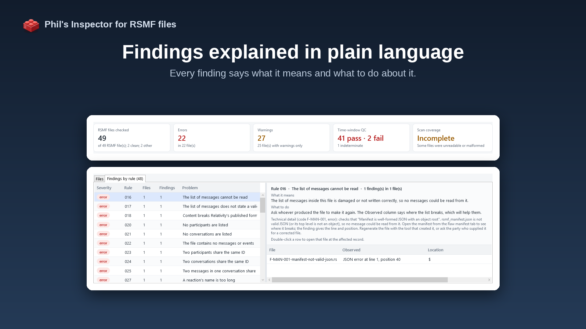
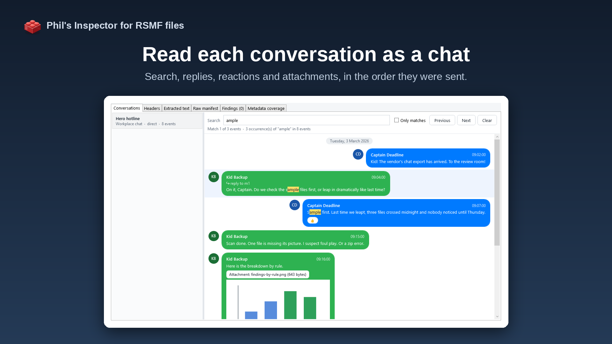

# Phil's Inspector for RSMF files

**Free and open source under the [MIT License](LICENSE).**

A Windows desktop app and command-line tool that checks Relativity Short Message Format (`.rsmf`)
files on your own PC before they are loaded into Relativity. It runs entirely offline: no
telemetry, tracking or ads.

**Why?

In eDiscovery, chat and text messages are often the most important evidence in a matter. They are also the least standardized: every forensic provider builds RSMF files its own way, and defects are common and hard to predict.

Those defects usually surface only after the data is loaded, during review. Where hosting is always billed on peak data volume, that means paying to process and store bad files before anyone knows they are bad.

This app moves the check to the front. It inspects RSMF files on a local PC before they are loaded, explains each defect in plain language, and produces a findings list to send back to whoever made the files. Where formal review is not needed, it can also convert conversations to PDF.

It is free and open source under the MIT License, runs entirely offline, and sends no data anywhere. No telemetry, no tracking, no ads. Free and open source. 

## Get the app

**Portable ZIP (no installation):**
[download the latest release](https://github.com/philweldon/Phil-s-Inspector-for-RSMF/releases/latest),
unzip it anywhere and run `RsmfInspector.exe`. The program is not code-signed, so Windows
SmartScreen may ask you to confirm the first time you run it.





## About

It performs local checks only. It does not certify files and does not guarantee Relativity ingestion.

**Licence:** MIT, copyright (c) 2026 Philip Weldon. See [LICENSE](LICENSE). Third-party
components and their licences are listed in [THIRD-PARTY-NOTICES.md](THIRD-PARTY-NOTICES.md).

This is an independent project. It is not affiliated with, endorsed by or supported by
Relativity ODA LLC. "Relativity" and "RSMF" are used only to say which file format the tool reads.

- User documentation: [USER_GUIDE.md](USER_GUIDE.md)
- Rules and their sources: [docs/RULES.md](docs/RULES.md)
- Manual smoke test for the GUI: [docs/SMOKE_TEST.md](docs/SMOKE_TEST.md)
- Recent releases and their checksums: [releases/INDEX.md](releases/INDEX.md)

## Layout

| Project | What it is |
|---|---|
| `src/Rsmf.Core` | All parsing, validation, QC and reporting. No UI dependencies; builds on any OS. |
| `src/Rsmf.Cli` | Command-line logic over the core library. Since 1.14.0 it is compiled into `RsmfInspector.exe`, which is the only program shipped; `rsmf-inspect` still builds for development and tests. |
| `src/Rsmf.App` | WPF GUI `RsmfInspector` over the core library (Windows only). |
| `tests/Rsmf.Tests` | xUnit tests and the fixture generator that builds synthetic `.rsmf` files. |
| `schemas/` | The published RSMF manifest schemas (1.0.0 and 2.0.0), embedded into `Rsmf.Core`. |

The application version lives only in `Directory.Build.props`. The ruleset version lives in
`docs/RULES.md` and `RuleCatalog.RulesetVersion`; a test fails if the two disagree.

## Requirements

- .NET 10 SDK.
- Access to nuget.org for the first restore (MimeKit, NodaTime, JsonSchema.Net, xUnit).
- Windows to build `Rsmf.App`. On another OS, Microsoft's SDK can cross-build it with
  `-p:EnableWindowsTargeting=true` (already set in the project); distribution-built SDKs that
  omit the Windows Desktop SDK cannot.

## Test

```
dotnet test tests/Rsmf.Tests/Rsmf.Tests.csproj -c Release
```

To keep the generated fixture folder (26 synthetic `.rsmf` files and 2 other files):

```
set RSMF_FIXTURES_OUT=C:\path\to\fixtures      (Windows)
export RSMF_FIXTURES_OUT=/path/to/fixtures      (Linux/macOS)
dotnet test tests/Rsmf.Tests/Rsmf.Tests.csproj -c Release
```

## Build the app

```
dotnet build src/Rsmf.App/Rsmf.App.csproj -c Release -r win-x64
```

## Build the portable package

```
dotnet publish src/Rsmf.App/Rsmf.App.csproj -c Release -r win-x64 --self-contained true -p:PublishSingleFile=true -o publish/win-x64
dotnet publish src/Rsmf.Cli/Rsmf.Cli.csproj -c Release -r win-x64 --self-contained true -p:PublishSingleFile=true -o publish/win-x64
```

Zip the contents of `publish/win-x64` together with `USER_GUIDE.md`, `docs/RULES.md`,
`THIRD-PARTY-NOTICES.md` and a `samples` folder (generate it with
`RSMF_SAMPLES_OUT=<folder> dotnet test tests/Rsmf.Tests/Rsmf.Tests.csproj`). The result runs from any user-writable folder: no installer, no
registry writes, no network calls, no first-launch downloads. `RsmfInspector.exe` is a single
file plus the few native WPF libraries .NET keeps beside it, so nothing is extracted to the
temp folder at start-up.

`RsmfInspector.exe --selftest <log file> [<.rsmf file>]` is a start-up self-check: it confirms
the main window renders and the viewer loads the file, writes each step to the log, shows no
dialogs and exits 0 (pass), 1 (failure) or 2 (timed out).

`build.cmd` is a helper used during development: it waits for a request file in `buildlogs/`
and runs one of seven fixed commands (test, app build, publish, smoke, launch, pack, shots). It is not needed to
build the project by hand.

## Run the CLI

```
rsmf-inspect scan <folder-or-file> --out <output-folder> [--tz <IANA zone>] [--mode both|elapsed-only]
             [--size-threshold <GB>] [--participant-threshold <n>] [--include-sensitive] [--quiet]
rsmf-inspect --version
```

Exit codes: 0 completed with no error findings; 1 completed with error findings or exceptions;
2 cancelled or failed; 64 bad arguments.

## Dependencies

| Package | Version | Licence | Used for |
|---|---|---|---|
| MimeKit | 4.18.2 | MIT | MIME parsing |
| NodaTime | 3.3.7 | Apache-2.0 | All time-zone work (bundled tz database) |
| JsonSchema.Net | 7.4.0 | MIT | Manifest validation against the published schemas |

Transitive packages and their licences are listed in `THIRD-PARTY-NOTICES.md`.
